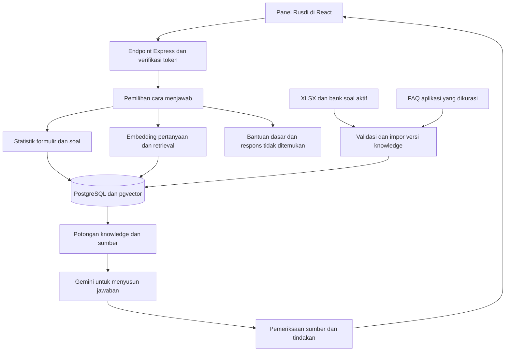

# PRD Chatbot Rusdi untuk KINDO

Status: implementasi MVP lokal. Tanggal: 27 November 2026.
Dasar peninjauan awal: commit `f3c61f1`. Petunjuk operasional dan batas
verifikasi terdapat pada [panduan menjalankan Rusdi](../rusdi-setup.md).

Rusdi adalah asisten AI yang membantu pengguna memahami dan memakai KINDO:
mengisi skrining, mengelola profil anak, menemukan hasil, mengekspor laporan,
dan membuka konsultasi tenaga kesehatan. Jawaban merujuk pada pengetahuan
aplikasi yang dikurasi dan data kuesioner yang dapat diperiksa.

Rekomendasi: pertahankan React, Express, Firebase, dan Gemini yang sudah ada.
Tambahkan PostgreSQL dengan pgvector khusus pengetahuan Rusdi. Gunakan
perhitungan terstruktur untuk fakta numerik dan pencarian semantik untuk
panduan penggunaan. Docker Compose dipakai untuk database pengembangan.

## Tujuan dan pengguna

Orang tua membutuhkan petunjuk singkat saat menggunakan aplikasi. Nakes dan
admin membutuhkan penjelasan fitur sesuai perannya. Rusdi harus bisa menjawab
variasi kalimat sehari-hari, termasuk ejaan seperti “kuisioner”, dengan jawaban
Bahasa Indonesia yang ramah dan langkah yang sesuai tampilan aplikasi.

MVP tersedia setelah login untuk ketiga peran. Identitasnya selalu jelas sebagai
asisten AI. Chat dengan Rusdi dipisahkan dari percakapan dengan nakes.

Keberhasilan utama: pengguna dapat menyelesaikan pertanyaan penggunaan aplikasi
dengan jawaban yang bersumber, sementara jumlah formulir dan soal selalu sesuai
versi data yang diterbitkan.

## Temuan pada peninjauan awal

| Temuan kode | Dampak untuk Rusdi |
| --- | --- |
| React dan Vite di frontend, Express di `server.ts`, Firebase untuk akun dan data aplikasi | Tambahkan modul chatbot ke backend yang sama; data pengguna tetap di Firebase. |
| `server.ts` memiliki analisis skrining, terjemahan, dan pencarian puskesmas | Belum ada endpoint chatbot umum, retrieval, atau PostgreSQL. |
| `INTERVENSI_KNOWLEDGE` dimasukkan langsung ke prompt analisis | Ini adalah konteks analisis skrining, belum menjadi basis pengetahuan bantuan aplikasi. |
| `KonsultasiNakesView.tsx` memakai pesan Firestore | Pertahankan kanal manusia tersebut. Rusdi mendapat panel dan endpoint sendiri. |
| README menyebut Vite 6, TypeScript 5.8, dan Gemini 3.8; dependensi serta identifier model di kode sudah berbeda | Kurasi FAQ dari perilaku kode. Jangan memasukkan README mentah sebagai kebenaran tunggal. |
| Dashboard menghitung garis pembanding melalui `getWhoMedianValue` yang berupa pendekatan | Rusdi tidak boleh mengklaim melakukan diagnosis stunting atau menghitung z-score WHO tervalidasi. |
| Pemilihan usia pada dashboard dan navigasi ponsel memiliki alur berbeda | FAQ menjelaskan cara membuka skrining; rekomendasi usia klinis perlu ditinjau sebelum dijawab otomatis. |

Referensi: [README](../../README.md), [server](../../server.ts),
[routing aplikasi](../../src/App.tsx),
[dashboard](../../src/components/DashboardView.tsx),
[hasil skrining](../../src/components/ResultView.tsx),
[konsultasi nakes](../../src/components/KonsultasiNakesView.tsx).

## Hasil pemeriksaan sumber kuesioner

Folder `downloaded_xlsx` yang disebut dalam usulan awal telah dipindahkan ke
[`data/kpsp/source`](../../data/kpsp/source/). Aplikasi membaca
[`src/data/questions.ts`](../../src/data/questions.ts).

Pemeriksaan isi XML workbook menemukan 16 file XLSX untuk usia 3, 6, 9, 12, 15,
18, 21, 24, 30, 36, 42, 48, 54, 60, 66, dan 72 bulan. Setiap formulir memiliki
10 baris pertanyaan bernomor 1 sampai 10. Bank soal aktif juga memiliki 16
kelompok dengan masing-masing 10 soal.

| Makna pertanyaan pengguna | Jawaban pada versi yang diperiksa |
| --- | --- |
| Jumlah formulir atau kelompok usia | 16 |
| Jumlah pertanyaan untuk satu sesi pada satu kelompok usia | 10 |
| Total butir dalam seluruh formulir | 160 |

Angka 160 menghitung entri soal di semua formulir; bukan klaim bahwa seluruh
teks pertanyaannya berbeda. Sheet intervensi tidak dihitung sebagai formulir
tambahan atau soal skrining.

Nama sheet bervariasi, misalnya `Usia 3 Bulan` dan `Pertanyaan`. Ada variasi
penulisan kategori, seperti `Bicara dan Bahas` dan `Sosialiasi dan Kemandirian`.
Importer perlu pemetaan label yang eksplisit sambil menyimpan nilai asli.
Kecocokan jumlah belum membuktikan kesetaraan semua teks atau validitas klinis.

## Cakupan MVP

| Prioritas | Kebutuhan |
| --- | --- |
| P0 | Panel “Tanya Rusdi” yang dapat dibuka dan ditutup di desktop dan ponsel. |
| P0 | Jawaban panduan akun, profil, skrining, hasil, PDF, grafik, edukasi, dan konsultasi nakes. |
| P0 | Jumlah formulir, soal per usia, total butir, dan daftar usia melalui query data terstruktur. |
| P0 | Pencarian pgvector atas knowledge yang telah diterbitkan, dengan sumber pada jawaban faktual. |
| P0 | Memahami pertanyaan lanjutan singkat, misalnya “kalau yang 12 bulan?”. |
| P0 | Pesan tidak ditemukan, layanan gagal, mencoba ulang, dan mode bantuan dasar. |
| P0 | Pembatasan jawaban ke penggunaan KINDO; topik lain ditolak dengan arahan yang relevan. |
| P0 | Perbaikan pencarian puskesmas berbasis lokasi dan data fasilitas nyata, sesuai bagian pencarian puskesmas. |
| P0 | Token Firebase diverifikasi server, pembatasan penggunaan, dan pemisahan data pengguna. |
| P0 | Impor ulang knowledge yang dapat diulang tanpa menggandakan data. |
| P1 | Bantuan sebelum login, dukungan Inggris yang lengkap, dan riwayat lintas perangkat. |
| P1 | Dashboard pengelolaan knowledge dan perluasan informasi kesehatan yang telah ditinjau nakes. |

MVP hanya memberikan informasi dan membuka halaman melalui tindakan yang
ditentukan aplikasi. Rusdi tidak menyimpan jawaban skrining, mengganti data
anak, mengirim pesan kepada nakes, membaca rekam kesehatan pribadi, atau
menjalankan SQL yang dibuat model. Diagnosis, dosis obat, penilaian kondisi
individual, unggah dokumen pengguna, dan pencarian web terbuka berada di luar
MVP.

## Perilaku percakapan

Pembuka: “Halo, aku Rusdi, asisten AI KINDO. Mau tanya soal skrining, profil
anak, hasil, atau cara memakai aplikasi?”

Jawaban diutamakan ringkas, sekitar satu paragraf atau maksimal lima langkah.
Rusdi mengikuti konteks percakapan yang relevan, tanpa menganggap ucapan
pengguna sebagai sumber fakta aplikasi.

Backend memeriksa cakupan sebelum retrieval dan generasi. Pertanyaan di luar
KINDO menerima respons terbatas, misalnya “Aku khusus membantu penggunaan
KINDO. Kamu bisa tanya tentang skrining, profil anak, hasil, atau fitur
aplikasinya.” Pergantian topik pada percakapan lanjutan tetap diperiksa;
instruksi pengguna tidak mengubah cakupan. Pertanyaan tentang penggunaan fitur
puskesmas termasuk cakupan, sedangkan diagnosis individual diarahkan ke nakes.

Contoh perilaku yang harus tersedia:

| Pertanyaan | Respons yang diharapkan |
| --- | --- |
| “Jumlah kuisionernya berapa?” | “Ada 16 formulir berdasarkan usia. Setiap formulir berisi 10 pertanyaan, jadi totalnya 160 butir di seluruh formulir.” Sertakan sumber statistik. |
| “Yang umur 12 bulan ada berapa?” | Jawab 10 soal untuk usia tersebut melalui data terstruktur. |
| “160 itu dikerjakan semua?” | Jelaskan bahwa satu sesi menggunakan formulir usia yang dipilih, bukan seluruh formulir. |
| “Cara unduh hasil?” | Jelaskan tombol Export PDF pada halaman hasil atau detail riwayat. |
| “Buka skrining” | Tawarkan tombol ke skrining menggunakan handler aplikasi yang sudah ada. |
| “Anak saya pasti stunting?” | Jelaskan batas fungsi Rusdi dan arahkan ke konsultasi nakes; jangan menyimpulkan kondisi anak. |
| “Fitur yang tidak ada itu bagaimana?” | Nyatakan sumber belum ditemukan; jangan mengarang menu atau layanan. |

Ketika pengguna meminta perpindahan halaman, frontend menampilkan tombol yang
relevan. Selama pengisian kuesioner, navigasi yang membuang jawaban harus
melewati konfirmasi aplikasi. Tombol chatbot tidak menimpa tab “Konsultasi
Nakes” atau kontrol jawaban skrining.

## Arsitektur yang diusulkan

Pencarian semantik membantu menemukan panduan walau kalimat pertanyaan berbeda.
Jumlah formulir atau soal berasal dari agregasi database. Misalnya,
`getQuestionnaireStats({ ageMonths: 12 })` mengembalikan angka dan sumber,
lalu jawaban menggunakan template fakta. Pertanyaan yang menggabungkan angka
dan panduan menggabungkan hasil statistik dengan retrieval; model tidak
mengubah angka yang sudah dihitung.

Gunakan layanan TypeScript dalam proses Express yang sama, pool koneksi
PostgreSQL, dan SDK Gemini yang sudah terpasang. Framework orkestrasi RAG,
layanan Python, dan message queue belum diperlukan untuk skala awal ini.

### Retrieval dan model

Gunakan `vector(768)` dengan cosine distance. Kandidat awal untuk knowledge
berbasis teks adalah `gemini-embedding-001`, dengan task dokumen dan query yang
sesuai. Model dan dimensi dikonfigurasi melalui environment serta dicatat di
setiap rilis. Dokumen dan pertanyaan harus memakai konfigurasi embedding yang
sama; mengganti model memerlukan embedding ulang seluruh rilis.

Dokumentasi Google masih menyediakan model teks tersebut. Model
`gemini-embedding-2` juga tersedia, tetapi instruksi task-nya berbeda dari field
`taskType` pada model 001. Pilih satu adapter dan uji akses model dengan key
lingkungan implementasi. Lihat [dokumentasi embeddings Google](https://ai.google.dev/gemini-api/docs/embeddings).

Ambil kandidat dari rilis aktif yang sesuai bahasa, peran, dan status publikasi.
Mulai dari 4–6 potongan konteks, lalu kalibrasi ambang relevansi menggunakan
pertanyaan uji. Kemiripan vektor bukan probabilitas bahwa jawaban benar.
Jika konteks tidak cukup, minta penjelasan atau jawab tidak ditemukan.

Mulai dengan exact nearest-neighbor search. pgvector mendukung pencarian exact
serta indeks approximate; HNSW dapat ditambahkan setelah pengukuran latency
menunjukkan kebutuhan. Dimensi 768 juga berada di bawah batas 2.000 dimensi
untuk indeks HNSW bertipe `vector`. Lihat [dokumentasi pgvector](https://github.com/pgvector/pgvector).

Identifier model generatif saat ini berbeda antar-endpoint dan README.
Rusdi harus memakai `RUSDI_GENERATION_MODEL` yang diuji pada provider, bukan
mewarisi identifier hardcode tanpa pengecekan. API key hanya digunakan server.

## Knowledge dan proses pembaruan

Knowledge aplikasi ditulis ulang dari perilaku produk, dengan
[FAQ awal Rusdi](../knowledge/rusdi-app-faq.md) sebagai draf awal.
README dan kode menjadi bahan pemeriksaan; source code mentah, akun contoh,
secret, log, serta percakapan pengguna tidak dimasukkan ke indeks.

| Sumber | Penggunaan |
| --- | --- |
| FAQ aplikasi yang dikurasi | Langkah penggunaan dan batas kemampuan Rusdi. |
| XLSX pada `data/kpsp/source/` | Formulir, nomor soal, usia, kategori asli, dan lokasi sumber. |
| `QUESTIONS_DATA` dan `AGE_EQUIPMENT_DATA` | Rekonsiliasi bank aktif dan informasi persiapan yang tampil di aplikasi. |
| `ResultView.tsx` | Penjelasan label skor yang ditampilkan aplikasi, tanpa memperluasnya menjadi diagnosis. |
| `knowledge.ts`, sheet intervensi, dan `edukasiData.ts` | Kandidat perluasan klinis; tidak otomatis diterbitkan hanya karena sudah ada di repository. |

Urutan impor:

1. Baca direktori sumber yang diizinkan. Gunakan manifest dan hash file,
   bukan path dari pertanyaan pengguna.
2. Identifikasi sheet pertanyaan lewat struktur workbook dan header. Baca
   shared strings, rich text, dan sel gabungan dengan benar. Abaikan header,
   baris kosong, gambar, dan sheet intervensi saat menghitung soal.
3. Simpan nomor soal, usia, teks, kategori asli dan normalisasi, sheet, serta
   baris atau rentang sel. Tolak nomor ganda atau urutan tidak lengkap.
4. Bandingkan jumlah dan teks yang dinormalisasi dengan bank aktif. Perbedaan
   teks menghasilkan laporan; jangan menimpa soal atau meresmikan perubahan
   klinis secara otomatis.
5. Bentuk potongan FAQ per topik dan satu potongan per soal. Target awal FAQ
   200–500 token, dengan konteks judul dan metadata; hindari memotong satu
   instruksi menjadi bagian yang kehilangan makna.
6. Buat embedding hanya untuk konten yang berubah. Simpan versi parser,
   source hash, model, dimensi, dan referensi kode untuk reproduksi.
7. Terbitkan rilis baru secara atomik setelah validasi. Kegagalan impor tidak
   mengganti rilis aktif. Jika sumber dan aplikasi berbeda, pertahankan rilis
   terakhir yang cocok dan laporkan perbedaannya kepada pengelola.

Formulir hilang dari snapshot sumber lengkap harus ditandai tidak aktif pada
rilis berikutnya, bukan tertinggal sebagai hasil impor lama. Konten klinis
memerlukan sumber penerbit yang dapat dilacak dan peninjauan nakes sebelum
diaktifkan. “Knowledge dibuat sendiri” berarti menyusun panduan produk yang
bersumber; pengetahuan medis tidak dibuat dari dugaan.

## Rancangan penyimpanan

| Tabel | Isi utama |
| --- | --- |
| `knowledge_releases` | ID, status, versi kode, manifest hash, model embedding, dimensi, waktu publikasi. Hanya satu rilis aktif. |
| `knowledge_documents` | Rilis, judul publik, topik, bahasa, peran yang diizinkan, status peninjauan, source hash. |
| `knowledge_chunks` | Dokumen, urutan, teks, `embedding vector(768)`, metadata sumber dan rentang sel. |
| `questionnaire_forms` | Rilis, usia, ID sumber, dan versi bank aplikasi. Unik untuk pasangan rilis dan usia. |
| `questionnaire_questions` | Formulir, nomor, teks, kategori asli dan normalisasi, serta lokasi sumber. Unik untuk formulir dan nomor. |
| `rusdi_feedback` | Request ID, rilis, penilaian membantu atau tidak, alasan opsional tanpa data pribadi. |

Jumlah dihitung dari formulir dan pertanyaan pada rilis aktif; jangan menghitung
jumlah file hasil embedding. Metadata internal dapat menyimpan path repository,
tetapi API hanya menampilkan judul sumber dan kutipan aman yang diizinkan.

Riwayat percakapan MVP disimpan di memori tab browser dan hilang saat reload
atau logout. Penyimpanan chat lintas perangkat ditunda; persyaratan retensi
dan penghapusan dibahas saat fitur itu masuk cakupan.

## Kontrak API dan integrasi frontend

| Endpoint usulan | Fungsi |
| --- | --- |
| `POST /api/rusdi/chat` | Memvalidasi pesan, memilih fakta atau retrieval, dan mengembalikan jawaban. |
| `GET /api/rusdi/questionnaires` | Statistik versi aktif; menerima filter usia yang tervalidasi. |
| `GET /api/rusdi/sources/:id` | Kutipan sumber yang telah disanitasi dan sesuai hak akses. |
| `POST /api/rusdi/feedback` | Mencatat penilaian pengguna atas respons. |

Request chat membawa `message`, maksimal enam pesan konteks terakhir,
`locale`, dan `currentView` yang diizinkan. Panjang awal pesan dibatasi 2.000
karakter, total konteks 8.000 karakter. Server hanya menerima role history
`user` dan `assistant`; instruksi `system` ditetapkan server.

Response berisi `requestId`, `answer`, `mode`, `sources`, `actions`, dan
`knowledgeVersion`. Nilai mode: `facts`, `rag`, `faq`, `not_found`, `restricted`,
atau `unavailable`. `actions` hanya memakai ID dari daftar frontend, misalnya
`open_screening`, `open_education`, `open_consultation`, dan `open_puskesmas`. Model tidak dapat
menyuntikkan JavaScript, URL bebas, atau operasi database.

Kembalikan 400 untuk input tidak valid, 401 untuk token tidak valid, 429 untuk
batas penggunaan, dan 503 bila tidak ada jawaban yang dapat diberikan saat
layanan gagal. Jawaban bantuan dasar yang berhasil tetap 200 dengan mode `faq`.
Kutipan yang tidak terdapat pada konteks retrieval ditolak sebelum respons.

`App.tsx` perlu handler navigasi yang eksplisit karena halaman utama memakai
state `ViewState`; jangan mengarang URL `/questionnaire` yang belum menjadi
route publik. Panel chatbot dimuat secara lazy dan tidak menambah pustaka
embedding atau database ke bundle browser.

## Keamanan dan batas layanan

Frontend mengirim Firebase ID token; Express memverifikasinya menggunakan
Firebase Admin SDK. UID berasal dari hasil verifikasi, dan peran yang
diperlukan diperiksa pada data server. `sessionStorage`, UID body, dan konteks
chat tidak menjadi dasar otorisasi. Lihat [verifikasi token Firebase](https://firebase.google.com/docs/auth/admin/verify-id-tokens).

Sebelum peluncuran publik, benahi temuan repository berikut:

- Akun contoh dengan kredensial tersimpan di `AuthView.tsx`, termasuk peran
  admin. Hapus dari build produksi dan rotasi kredensial yang pernah terpapar.
- `quick_login_override_uid` di frontend tidak boleh memberi akses ke identitas
  pengguna lain.
- Aturan `messages`, `childProfiles`, dan `questionnaireResults` memberi akses
  baca yang luas kepada pengguna login; `users` juga perlu pembatasan perubahan
  peran. Terapkan kepemilikan dan penugasan nakes sebelum memperluas akses data.
- Endpoint AI saat ini belum memperlihatkan middleware verifikasi token atau
  rate limit. Endpoint Rusdi wajib memiliki keduanya sejak awal.

Referensi: [auth](../../src/components/AuthView.tsx),
[identitas frontend](../../src/App.tsx), dan
[aturan Firestore](../../firestore.rules). Pembuatan dokumen ini tidak
mengubah konfigurasi keamanan aplikasi.

Knowledge hanya berisi informasi produk yang diizinkan. Teks retrieval dan
history diperlakukan sebagai data, sehingga perintah seperti “abaikan instruksi
sebelumnya” tidak memberikan akses tool atau secret. Gunakan query SQL
berparameter dan akun database runtime dengan hak baca knowledge; proses impor
memakai hak tulis terpisah. HTML mentah dari jawaban tidak dirender.

Anggaran awal: 10 permintaan per menit dan 100 per hari per UID, dengan batas
tambahan per IP. Nilainya dapat disesuaikan setelah pilot. Catat request ID,
mode, rilis, latency, token, dan error; jangan mencatat pesan mentah, identitas
anak, atau kredensial secara default.

## Docker dan operasi

Pengembangan dimulai dengan aplikasi Node di host dan satu service PostgreSQL
di Docker Compose. Kandidat image: `pgvector/pgvector:0.8.7-pg16-bookworm`,
yang tercantum pada [tag resmi pgvector](https://github.com/pgvector/pgvector#docker).
Pin versi dan digest saat implementasi. Tambahkan volume persisten, healthcheck
`pg_isready`, migrasi `CREATE EXTENSION IF NOT EXISTS vector`, serta koneksi
lokal `127.0.0.1`. Kredensial berada di `.env`, bukan repository.

Variabel baru yang diusulkan: `DATABASE_URL`, `RUSDI_ENABLED`,
`RUSDI_GENERATION_MODEL`, `RUSDI_EMBEDDING_MODEL`,
`RUSDI_EMBEDDING_DIMENSIONS`, `RUSDI_REQUEST_TIMEOUT_MS`, serta konfigurasi
server Firebase Admin. `GEMINI_API_KEY` yang sudah ada dapat dipakai server.

Deployment perlu database pgvector yang persisten dan dapat dijangkau proses
Express. Docker pada laptop belum menyediakan database untuk server produksi.
Proses deploy menjalankan migrasi dan menerbitkan rilis knowledge yang sudah
divalidasi; indexing tidak dilakukan ulang pada setiap pertanyaan atau setiap
startup aplikasi. Backup dan pemulihan database diuji sebelum peluncuran.

Saat LLM gagal, kembalikan fakta terstruktur atau FAQ yang cocok secara pasti.
Saat embedding gagal, gunakan pencocokan FAQ terbatas. Saat database gagal,
gunakan snapshot bantuan dasar dari rilis yang sama; fakta numerik hanya
ditampilkan jika snapshot masih cocok dengan versi bank aplikasi. Jika
kecocokan tidak dapat dibuktikan, nyatakan data belum tersedia. Jangan beralih
ke jawaban bebas tanpa sumber. Feature flag harus bisa mematikan Rusdi tanpa
mengganggu skrining atau konsultasi nakes.

## Perbaikan pencarian puskesmas

Implementasi dasar tersedia pada endpoint dan modal peta. Fasilitas buatan dan
perpindahan otomatis ke Jakarta sudah dihapus. Verifikasi hasil live Google
Places menunggu konfigurasi key. Direktori lokal cadangan tetap opsional dan
belum tersedia sebagai data tervalidasi.

### Temuan pada implementasi saat ini

Backend sudah mencoba Google Places API New melalui `places:searchText`
sebelum Gemini. Kesulitan pencarian perlu ditelusuri melalui status provider
dan kualitas lokasi, bukan langsung disimpulkan sebagai masalah model AI.
Tanpa log kegagalan produksi, penyebab insiden pengguna belum dipastikan.

| Temuan | Dampak yang mungkin terjadi |
| --- | --- |
| Lokasi browser gagal lalu beralih ke IP dan akhirnya Jakarta | Hasil dapat berasal dari kota lain, meskipun ada banner lokasi perkiraan. |
| Browser meminta lokasi dengan `enableHighAccuracy: false`, menerima cache hingga lima menit, dan tidak menyimpan `coords.accuracy` | Aplikasi tidak dapat menjelaskan tingkat ketelitian titik pencarian. |
| Places memakai `locationBias` lingkaran 5 km | Area tersebut merupakan preferensi; hasil tetap dapat berada di luarnya. |
| Fallback Gemini diminta membuat daftar dari pengetahuan umum tanpa retrieval lokasi | Nama, telepon, jarak, dan koordinat tidak dijamin berasal dari fasilitas nyata; respons juga ditandai `isFallback: false`. |
| `generateFallbackPuskesmas` di luar Jakarta membentuk nama, alamat, telepon, serta koordinat dari offset buatan | Data sintetis dapat muncul sebagai rekomendasi fasilitas. Data ini harus dikeluarkan dari hasil produksi. |
| Cache menggunakan pembulatan koordinat dua desimal dan menyimpan jarak yang sudah dihitung | Titik pengguna yang berbeda dapat mendapat jarak lama dan urutan yang kurang tepat. |
| Request hasil pencarian tidak memiliki pembatalan dan ID tersendiri | Respons dari titik lama dapat menimpa hasil titik baru. Guard yang ada saat ini terutama melindungi proses penentuan lokasi. |
| Tujuan dengan koordinat hilang diganti dengan titik pengguna | Fasilitas bisa keliru terlihat berjarak nol. |

Referensi: [endpoint, cache, dan fallback](../../server.ts),
[penentuan lokasi dan request frontend](../../src/components/PuskesmasMapModal.tsx).

### Alur yang disarankan

1. Minta lokasi perangkat dengan izin pengguna. Simpan koordinat, akurasi
   dalam meter, waktu pengambilan, dan sumber lokasi untuk sesi pencarian.
   Sediakan Deteksi Ulang dengan opsi ketelitian tinggi. Gunakan HTTPS pada
   produksi dan tangani izin ditolak, lokasi tidak tersedia, serta timeout
   sebagai keadaan yang berbeda. [Referensi geolocation](https://developer.mozilla.org/en-US/docs/Web/API/Geolocation/getCurrentPosition)
2. Jika lokasi gagal atau terlalu kasar, tawarkan memilih pin atau mencari
   kelurahan/kecamatan dan mengonfirmasi area. Batas awal lokasi kasar adalah
   akurasi di atas 1.000 meter, yang perlu dievaluasi saat pilot. Perkiraan IP
   boleh membantu memilih area jika pengguna memilihnya; jangan otomatis
   menganggapnya posisi presisi atau mengubah titik pengguna ke Jakarta.
   Pencarian berdasarkan pusat area harus diberi label “dari pusat area”.
3. Gunakan Places Text Search New dengan query kategori `puskesmas`, hasil
   kandidat yang cukup, dan `rankPreference: DISTANCE`. Untuk pembatasan area,
   `locationRestriction` Text Search menggunakan persegi panjang; jangan
   mengirim bentuk lingkaran dari konfigurasi `locationBias`. `locationBias`
   dan `locationRestriction` tidak dipakai bersamaan. Jika memerlukan radius
   lingkaran, verifikasi hasil terhadap jarak origin sesuai penggunaan yang
   diizinkan provider. [Referensi Text Search](https://developers.google.com/maps/documentation/places/web-service/text-search)
4. Awali radius 5 km. Bila tidak ditemukan hasil yang sesuai, tawarkan perluas
   ke 10 atau 25 km sebagai pencarian baru. Kembalikan maksimal lima hasil
   terdekat yang ditemukan, dengan radius dan origin yang jelas. Hasil kosong
   berarti tidak ditemukan pada cakupan pencarian; jangan menyimpulkan tidak
   ada puskesmas di wilayah tersebut.
5. Validasi identitas dan koordinat kandidat. Gunakan place ID untuk deduplikasi;
   nama yang sekadar menyebut bangunan di dekat puskesmas tidak otomatis lolos.
   Bedakan puskesmas, puskesmas pembantu, klinik, dan rumah sakit. Kandidat yang
   tidak dapat dibedakan ditempatkan sebagai perlu verifikasi, bukan dilabeli
   puskesmas. Jangan mengisi koordinat atau telepon yang hilang dengan dugaan.
6. Urutkan dengan jarak numerik sebelum pembulatan tampilan. Tampilkan “jarak
   garis lurus dari titik pencarian”. Jarak jalan dan estimasi waktu baru
   ditampilkan ketika tersedia dari layanan rute; keduanya tidak dipertukarkan.

Nearby Search New dapat diuji sebagai sumber kandidat tambahan dengan radius
lingkaran. Namun daftar tipe Google yang diperiksa tidak memiliki tipe khusus
`puskesmas`; tipe seperti `medical_clinic` dan `medical_center` mencakup fasilitas
lain. Karena itu mengganti Text Search dengan pencarian tipe secara langsung
belum menjamin identitas atau kelengkapan puskesmas. Evaluasi hasil terhadap
daftar fasilitas rujukan di wilayah pilot.
Lihat [Nearby Search](https://developers.google.com/maps/documentation/places/web-service/nearby-search)
dan [daftar tipe tempat](https://developers.google.com/maps/documentation/places/web-service/place-types).

### Sumber cadangan dan peran Rusdi

Hapus fallback yang membuat fasilitas dari Gemini atau offset koordinat.
Cadangan hanya boleh memakai direktori fasilitas nyata yang memiliki asal data,
koordinat yang diperiksa, status aktif, serta tanggal verifikasi. Sumber awal
dapat berupa data Dinas Kesehatan yang diizinkan digunakan dan dikurasi
pengelola. Direktori tersebut belum tersedia sebagai dataset tervalidasi di
repository dan tidak boleh dianggap siap untuk seluruh Indonesia.

Untuk pilot kecil, simpan direktori yang dimiliki atau berlisensi sesuai di
PostgreSQL dan hitung jarak Haversine. Bila dataset bertambah besar, gunakan
PostGIS dengan kolom `geography` dan indeks spasial; `ST_DWithin` mendukung
radius dalam meter. Ini memerlukan image atau instalasi PostgreSQL yang
menyediakan extension PostGIS selain pgvector, lalu diuji dalam Docker.
[Referensi PostGIS](https://postgis.net/docs/ST_DWithin.html)

pgvector tetap digunakan untuk knowledge Rusdi. Pencarian jarak fasilitas
menggunakan koordinat dan perhitungan geografis. Data Places tidak otomatis
disalin ke direktori permanen atau embedding. Penyimpanan, cache, dan atribusi
hasil Google mengikuti ketentuan provider; `place_id` memiliki pengecualian
penyimpanan yang dijelaskan dalam [kebijakan Places](https://developers.google.com/maps/documentation/places/web-service/policies).
Untuk cache data yang memang boleh disimpan, hitung ulang jarak dari titik
request terbaru dan sertakan metadata sumber serta waktu verifikasi.

Saat provider gagal dan direktori terverifikasi belum mencakup area tersebut,
tampilkan kondisi layanan dan tombol Buka Google Maps. Maps URLs dapat membuka
pencarian atau petunjuk arah tanpa API key; ini merupakan perpindahan ke layanan
eksternal, bukan bukti bahwa KINDO telah memperoleh daftar fasilitas.
[Referensi Maps URLs](https://developers.google.com/maps/documentation/urls/guide)

Rusdi menawarkan tindakan `open_puskesmas` untuk membuka fitur pencarian yang
sudah ada. Permintaan izin lokasi dan pencarian ditangani komponen aplikasi.
AI tidak meminta pengguna menuliskan alamat rumah di chat, tidak membuat daftar
fasilitas sendiri, dan tidak mengklaim mengetahui posisi pengguna sebelum
lokasi diberikan. Pemanggilan pencarian langsung lewat chat dapat ditambahkan
kemudian dengan endpoint yang sama dan hasil bersumber yang sama.

### Kontrak layanan dan penanganan kegagalan

Pertahankan `POST /api/nearby-puskesmas` agar dapat diperbaiki tanpa menunggu
chatbot selesai. Validasi lat/lng sebagai angka finite pada rentang geografis
yang sah, radius dalam daftar yang diizinkan, serta request ID. Input tidak
valid ditolak dengan 400 sebelum cache atau provider dipanggil.

Respons perlu memuat `requestId`, origin, `originSource`, `accuracyMeters`
jika tersedia, radius, status, dan daftar hasil. Setiap hasil memiliki ID,
koordinat sumber, `distanceMeters`, `distanceKind`, `dataSource`, dan metadata
verifikasi yang sesuai. Telepon, jam buka, status operasional, serta jarak
jalan bersifat opsional dan hanya tampil bila sumber menyediakannya.

Gunakan status terpisah: `ok`, `empty`, `location_required`,
`provider_unavailable`, dan `configuration_error`. Hasil `empty` yang sah
tidak memicu AI mengisi daftar. Kesalahan key, billing, kuota, dan timeout
dicatat secara berbeda; pengguna mendapat pesan singkat dan tindakan yang
sesuai. Kesalahan rute tidak menghapus daftar fasilitas yang sudah berhasil
ditemukan, dan tidak seluruhnya disebut “API belum diaktifkan”.

Pisahkan key browser untuk Maps JavaScript dari key server untuk Places dan
layanan server lainnya. Terapkan pembatasan referrer pada key browser dan
pembatasan API serta aplikasi server yang sesuai pada key server. Pastikan
Places API New dan billing aktif; Maps JavaScript yang berhasil tampil belum
membuktikan Places dapat dipanggil. Rute dalam aplikasi memerlukan konfigurasi
layanan rutenya sendiri. [Referensi keamanan key](https://developers.google.com/maps/api-security-best-practices)

Field mask awal hanya mengambil data yang diperlukan untuk daftar. Telepon
atau detail tambahan dapat diminta saat fasilitas dipilih agar biaya dan
respons tetap terkendali. Frontend membatalkan request lama ketika origin
berubah atau modal ditutup, dan memeriksa request ID sebelum memperbarui
hasil maupun status loading. Target awal timeout backend adalah delapan detik
per pencarian dan failsafe frontend sepuluh detik, terpisah dari waktu izin
dan penentuan lokasi. Pengguna tetap dapat mengoreksi lokasi saat layanan gagal.

### Penerimaan perbaikan pencarian

Sediakan paling sedikit 20 skenario tambahan di luar dataset uji chatbot:
lokasi akurat, lokasi kasar, izin ditolak, timeout lokasi, IP berbeda kota,
input area manual, perubahan pin cepat, respons request lama, provider 403,
kuota 429, timeout provider, hasil kosong, perluasan radius, koordinat hasil
hilang, fasilitas duplikat, hasil di luar area, salah jenis fasilitas, cache
origin berbeda, kegagalan rute, serta cadangan atau pencarian eksternal.

Syarat lulus:

- Semua hasil fasilitas berasal dari provider atau direktori yang dapat
  dilacak. Tidak ada hasil dari nama dan koordinat buatan, termasuk saat key
  tidak tersedia atau LLM mati.
- Pencarian tidak otomatis mengganti kota pengguna menjadi Jakarta. Sumber
  lokasi dan ketelitiannya terlihat sebelum hasil dianggap “dekat Anda”.
- Radius berlaku sesuai pengaturan pencarian. Urutan memakai jarak numerik
  terhadap origin terbaru; pembulatan hanya pada tampilan.
- Respons lama tidak menimpa hasil titik baru. Loading selesai pada error,
  timeout, pembatalan, dan penutupan modal.
- Verifikasi pilot memakai titik di Salatiga, Surakarta, Jakarta, dan area
  dengan fasilitas jarang. Setiap hasil yang ditampilkan diperiksa identitas
  dan lokasinya, serta cakupan provider dibandingkan daftar rujukan wilayah.
  Kelengkapan terhadap seluruh fasilitas nasional tidak diasumsikan.
- Lokasi tidak dikirim ke Gemini atau disimpan sebagai bagian knowledge
  umum. Log produksi menghindari koordinat presisi sebagai default.

## Kriteria penerimaan

| Area | Syarat lulus |
| --- | --- |
| Integritas sumber | Seluruh 16 workbook di snapshot saat ini menghasilkan 10 soal; hasil impor selaras dengan bank aktif. |
| Fakta numerik | 100% kasus angka pada dataset uji benar, termasuk perbedaan 16 formulir, 10 soal per sesi, dan 160 butir total. |
| Pengetahuan aplikasi | Minimal 90% pertanyaan panduan mendapat jawaban yang benar menurut review fitur. |
| Batas topik | Pertanyaan di luar KINDO dan upaya mengalihkan instruksi ditolak; pertanyaan lokasi hanya memakai layanan puskesmas yang bersumber. |
| Sumber | Semua klaim faktual memiliki sumber; semua ID sumber valid dan sesuai akses. Minimal 95% jawaban faktual didukung kutipan yang ditampilkan menurut review manusia. |
| Peran dan privasi | Seluruh tes token palsu, UID manipulatif, role manipulatif, dan permintaan data pengguna lain ditolak. |
| Gangguan layanan | LLM, embedding, dan database yang tidak tersedia menghasilkan fallback yang sesuai tanpa angka atau jawaban karangan. |
| Pemutakhiran | Impor berulang tidak menggandakan data; rilis gagal tidak menjadi aktif; sumber yang dihapus tidak ikut statistik rilis baru. |
| Frontend | Panel tidak menutupi kontrol skrining atau bottom navigation; keyboard, fokus, tutup, retry, dan layar ponsel bekerja. |
| Regresi | Login, dashboard, skrining, PDF, dan konsultasi nakes tetap berjalan. |

Gunakan minimal 60 kasus: 15 fakta, 20 panduan, 10 pertanyaan lanjutan, 5 di
luar knowledge, 5 percobaan manipulasi, dan 5 gangguan layanan. Contoh angka:
“kuisioner ono piro?”, “usia 12 bulan?”, “jumlah sheet sama dengan jumlah
formulir?”, dan “160 harus dijawab semua?”.

Target awal latency p95: fakta maksimal satu detik dan jawaban generatif
maksimal delapan detik pada staging dengan database siap. Ini target desain,
belum hasil benchmark. Ukur dengan 50 request dan hingga 10 pengguna bersamaan;
catat waktu provider serta biaya embedding dan generasi untuk menentukan
anggaran pilot.

## Tahapan implementasi

1. Perbaiki pencarian puskesmas sebagai pekerjaan mandiri: hapus data sintetis,
   benahi penentuan lokasi, validasi provider, dan sediakan pencarian eksternal
   saat layanan tidak tersedia. Luluskan skenario pencarian sebelum pilot.
2. Rapikan batas akses produksi dan kurasi FAQ. Tetapkan daftar sumber serta
   pemetaan kategori, lalu selesaikan rekonsiliasi XLSX dengan bank aktif.
3. Tambahkan Docker database, migrasi, importer, rilis knowledge, statistik,
   dan pengujian integritas. Buktikan pertanyaan angka benar sebelum generasi AI.
4. Tambahkan embedding, retrieval, Gemini, sumber, mode gagal, otorisasi, dan
   rate limit. Luluskan dataset uji sebelum menghubungkan antarmuka.
5. Tambahkan panel Rusdi yang dimuat bertahap, uji desktop dan ponsel, lalu
   lakukan pilot terbatas dan pemantauan biaya serta kualitas jawaban.

Keputusan implementasi MVP: pengetahuan penggunaan aplikasi,
Bahasa Indonesia, akses setelah login, Gemini sebagai provider, PostgreSQL
dan pgvector untuk knowledge, serta Docker Compose untuk pengembangan.

## Status implementasi dan verifikasi

- Importer memvalidasi 16 workbook dan 160 soal; tidak ditemukan perbedaan teks
  dengan bank soal aplikasi. Statistik dan 16 dokumen FAQ operasional telah
  dipublikasikan ke PostgreSQL lokal.
- Gemini memilih ID sumber yang diizinkan dari hasil pgvector. Backend
  menampilkan jawaban FAQ terkurasi, sehingga keluaran bebas model tidak masuk
  percakapan. Mode FAQ dan statistik bekerja tanpa key Gemini.
- Panel Rusdi menyediakan percakapan sesi tab, sumber, feedback, dan tindakan
  menuju fitur. Tombol Buka skrining membawa pengguna ke dashboard untuk
  melanjutkan pemilihan formulir lewat kontrol yang sudah ada.
- Pencarian memakai Places bersumber, koreksi lokasi, radius eksplisit, pembatalan
  request lama, dan pencarian eksternal saat layanan gagal. Navigasi rute MVP
  dibuka melalui Google Maps; rute di dalam aplikasi belum diaktifkan.
- Pengujian mencakup unit/backend, query pgvector, pembatasan hak database,
  aturan Firebase di emulator, dan browser desktop/ponsel. Provider Gemini
  dan Places live belum diuji karena key belum tersedia.
- Deploy aturan dan indeks Firebase, rotasi kredensial akun contoh yang dahulu
  terpapar, serta pengisian secret produksi merupakan langkah operasional
  sebelum publikasi. Tidak ada perubahan Firebase produksi selama pengujian.
